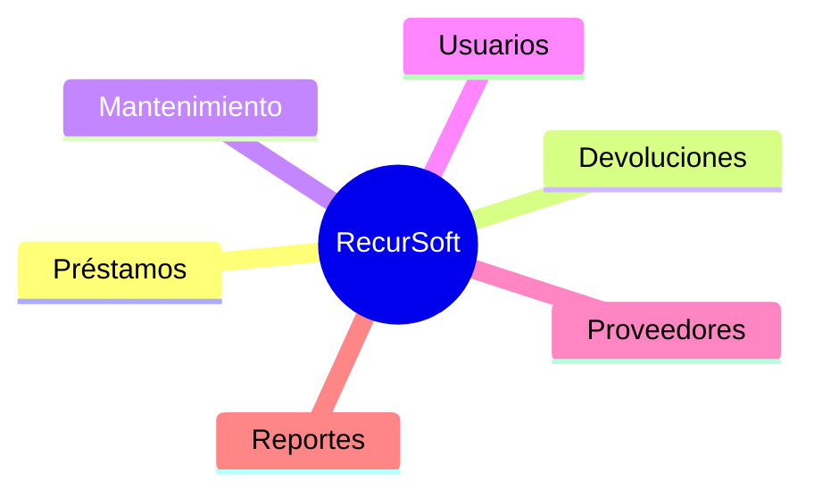

 

---

## 👨‍💻 Sobre mí

Aprendiz de **Análisis y Desarrollo de Software en el SENA**, con interés en la programación, el desarrollo web y la creación de soluciones tecnológicas para necesidades reales.

He participado en proyectos formativos como **RecurSoft**, un sistema para gestionar recursos institucionales. Sigo fortaleciendo mi lógica de programación, bases de datos, interfaces web y herramientas de desarrollo, con interés en la **innovación tecnológica**, la **arquitectura de software** y la **creación de contenidos educativos**.

> 💡 *Aprender, practicar y construir soluciones útiles, una línea de código a la vez.*

| 🧰 **11** | 📦 **6** | 🔐 **2** | ⚙️ **5** |
|:---:|:---:|:---:|:---:|
| tecnologías y herramientas documentadas | módulos en RecurSoft | roles con permisos | tecnologías en RecurSoft |

## 🎓 Educación

**Análisis y Desarrollo de Software (ADSO)** — Servicio Nacional de Aprendizaje (SENA) · Colombia · *en formación*

`Desarrollo de software` · `Programación y desarrollo web` · `Aprendizaje continuo` · `Tecnología con propósito`

## 🛠️ Stack técnico

| Categoría | Tecnologías |
|:--|:--|
| 🌐 **Lenguajes y web** |       |
| 🗄️ **Bases de datos** |  |
| 🧰 **Herramientas** |     |

- 🌐 **Web:** interfaces con HTML, CSS y Bootstrap; fundamentos de PHP con conexión a bases de datos; fundamentos de React y Flask.
- 🗄️ **Datos:** consultas y gestión básica con MySQL/MariaDB.
- 🐍 **Python:** variables, entrada de datos, listas, diccionarios y ciclos.
- 📋 **Análisis y documentación:** requerimientos funcionales, roles, permisos, reglas de negocio y matrices de requisitos.

## 🚀 Experiencia y proyectos

### 🧑‍💻 Desarrollador de software en formación
*Proyectos formativos · SENA, Colombia · Formación actual*

- 🔹 Análisis y desarrollo de **RecurSoft**: registro y control de recursos, préstamos, devoluciones, mantenimiento y reportes.
- 🔹 Desarrollo y adaptación de interfaces web con **HTML, CSS, Bootstrap y PHP**.
- 🔹 Trabajo con bases de datos **MySQL/MariaDB** y entorno local **XAMPP**.
- 🔹 Exploración de componentes con **React** y fundamentos de programación con **Python**.
- 🔹 Organización de requerimientos, módulos, roles de usuario y reglas de negocio.

### 📦 Proyecto destacado · RecurSoft

**Sistema de Gestión de Recursos Institucionales**

    

- ✅ Centraliza la información de los recursos institucionales.
- ✅ Roles de **administrador** y **empleado** con permisos diferenciados.

## 📚 Formación continua y habilidades personales

<table>
<tr>
<td valign="top" width="50%">

**📚 Formación continua**
- Lógica de programación con Python
- Desarrollo web con PHP, HTML, CSS y Bootstrap
- Fundamentos de React y Flask
- Bases de datos relacionales MySQL/MariaDB
- Control de versiones y publicación con GitHub
- Análisis de requerimientos y calidad del software

</td>
<td valign="top" width="50%">

**🤝 Habilidades personales**
- Trabajo en equipo
- Organización y responsabilidad
- Resolución de problemas
- Pensamiento lógico en desarrollo
- Creatividad y aprendizaje continuo
- Interés por compartir conocimiento y crear contenidos educativos

</td>
</tr>
</table>

## 🎯 Objetivos e idiomas

- 🏗️ Construir aplicaciones que resuelvan necesidades reales.
- 🧠 Profundizar en programación y arquitectura de software.
- 📁 Desarrollar un portafolio con proyectos documentados *(en construcción)*.
- 💡 Explorar soluciones de innovación tecnológica.
- 🗣️ **Idioma:** español (principal).

**📍 Medellín, Antioquia, Colombia · ✉️ corjero6@gmail.com · 📞 3242709729**

